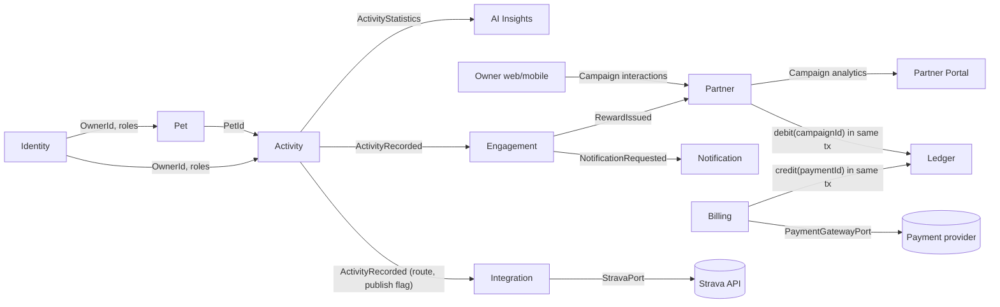

# Context Map

## Relationships

- **Identity → Pet/Activity**: shared kernel of owner identity; contexts reference `OwnerId` only.
- **Pet → Activity**: conformist on pet identity; Activity validates pet ownership through Pet port.
- **Activity → AI Insights**: customer/supplier; AI consumes read-only aggregates.
- **Activity → Engagement**: event-driven; Activity publishes facts, Engagement evaluates rules.
- **Engagement → Partner**: partner consumes reward/campaign contracts; coupon inventory remains Partner-owned.
- **Engagement → Notification**: event-driven notification requests.
- **Billing → Ledger / Partner → Ledger**: customer/supplier through the Ledger inbound port (`PostLedgerEntryUseCase`), executed in the caller's local transaction (ADR-0014).
- **Billing → Payment provider**: anti-corruption layer `PaymentGatewayPort` (ADR-0015).
- **Activity → Integration**: event-driven; Integration publishes to Strava asynchronously (ADR-0018).
- **Owner apps → Partner**: interaction tracking API feeding aggregate analytics (ADR-0016).

## Anti-corruption notes

- External AI providers are isolated behind `AiInsightProviderPort`.
- Strava is isolated behind `StravaPort`; payment providers behind `PaymentGatewayPort`; geocoding behind `GeocodingPort`; map tiles are configuration only.
- Frontend DTOs are API contracts, not domain models.
