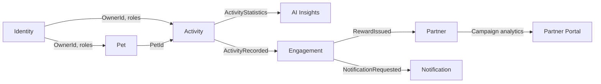

# Context Map

## Relationships

- **Identity → Pet/Activity**: shared kernel of owner identity; contexts reference `OwnerId` only.
- **Pet → Activity**: conformist on pet identity; Activity validates pet ownership through Pet port.
- **Activity → AI Insights**: customer/supplier; AI consumes read-only aggregates.
- **Activity → Engagement**: event-driven; Activity publishes facts, Engagement evaluates rules.
- **Engagement → Partner**: partner consumes reward/campaign contracts; coupon inventory remains Partner-owned.
- **Engagement → Notification**: event-driven notification requests.

## Anti-corruption notes

- External AI providers are isolated behind `AiInsightProviderPort`.
- Strava and map providers, if added, are isolated behind integration ports.
- Frontend DTOs are API contracts, not domain models.
