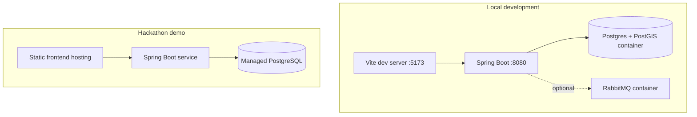

# Deployment Architecture

## Minimum viable topology



## Deployment units

| Unit | Technology | Responsibility |
|---|---|---|
| `frontend` | React + TypeScript + Vite + Tailwind | SPA and API client |
| `backend` | Java 21 + Spring Boot | Modular monolith API |
| `postgres` | PostgreSQL + PostGIS | System of record |
| `rabbitmq` | RabbitMQ | Optional asynchronous events |

## Environment strategy

- `local`: Docker Compose with Postgres/PostGIS and optional RabbitMQ.
- `demo`: same containers or managed equivalents; AI provider can be disabled.
- `prod`: HTTPS, managed PostgreSQL, secret manager, least-privilege DB user, backups.

## Scaling path

The monolith can scale vertically first. If activity ingestion or AI workloads justify it, extract Activity or AI Insights into services without changing domain contracts. Do not split Pet and Identity prematurely.

## Backup and recovery assumptions

- PostgreSQL automated backups for managed environments.
- Flyway migrations are forward-only after production release.
- Account deletion workflow must remove or anonymize owner-owned data according to retention policy.

## As-built (post-refactor, 2026-11, updated for the nginx edge chain)

`docker-compose.yml` runs `postgres` (postgis/postgis:17-3.5, published on
`127.0.0.1:5432` for host tools, `jit=off` — the short geospatial queries here do
not pay for JIT compilation), `backend`, `frontend`, plus three nginx hops on a
fixed `172.28.0.0/24` subnet (dynamic services are confined to `172.28.0.128/25`
so the proxy IPs below are stable):

```
Internet ─▶ gateway nginx (:5173 published, 172.28.0.3)
              ├─ /                        ─▶ frontend nginx (SPA, 172.28.0.10)
              │                               └─ /api/ ─▶ backend nginx (172.28.0.11) ─▶ backend :8080 ─▶ postgres
              └─ POST /api/webhooks/payments/ ─▶ backend nginx ─▶ backend :8080   (AbacatePay webhook)
```

- **gateway** — the only published port (`5173:80`). Everything proxies to the
  frontend nginx except `POST /api/webhooks/payments/`, which goes straight to the
  backend nginx. `GATEWAY_TRUSTED_PROXY_CIDR` names an optional external TLS proxy
  (e.g. Caddy in production); default trusts nothing.
- **frontend** — nginx serving the React SPA and proxying `/api/` to the backend
  nginx; trusts only the gateway (`TRUSTED_PROXY_CIDRS=172.28.0.3/32`).
- **backend-proxy** — nginx in front of Spring Boot; answers `/api/` only (404 for
  everything else) and accepts the frontend and gateway IPs.
- **backend** — Spring Boot `:8080` (also published on `127.0.0.1:8080` for local
  dev tools); trusts only `TRUSTED_PROXIES=172.28.0.11/32` when resolving
  `X-Forwarded-For`.

Details and per-hop trust table: `docs/architecture/edge-proxies.md`; production
deploy (Hostinger VPS + Caddy): `docs/deploy-hostinger.md`.

Local backend dev can still run `./gradlew bootRun` against the compose postgres
with env from `.env` (bypassing the nginx chain). Mobile is developed through Expo
(`npm run start`) and talks to the API base URL in `EXPO_PUBLIC_API_BASE_URL`; it
is not part of compose. Push notifications require an EAS `projectId`
(`app.json` → `extra.eas.projectId`) and `EXPO_PUSH_ENABLED=true` on the backend.
