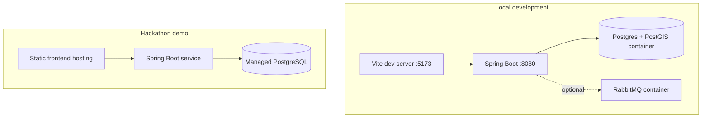

# Deployment Architecture

## Minimum viable topology

## Deployment units

| Unit | Technology | Responsibility |
|---|---|---|
| `frontend` | React + TypeScript + Vite + Tailwind | SPA and API client |
| `backend` | Java 21 + Spring Boot | Modular monolith API |
| `postgres` | PostgreSQL + PostGIS | System of record |
| `rabbitmq` | RabbitMQ | Optional asynchronous events |

## Environment strategy

- `local`: Docker Compose with Postgres/PostGIS and optional RabbitMQ.
- `demo`: same containers or managed equivalents; AI provider can be disabled.
- `prod`: HTTPS, managed PostgreSQL, secret manager, least-privilege DB user, backups.

## Scaling path

The monolith can scale vertically first. If activity ingestion or AI workloads justify it, extract Activity or AI Insights into services without changing domain contracts. Do not split Pet and Identity prematurely.

## Backup and recovery assumptions

- PostgreSQL automated backups for managed environments.
- Flyway migrations are forward-only after production release.
- Account deletion workflow must remove or anonymize owner-owned data according to retention policy.
