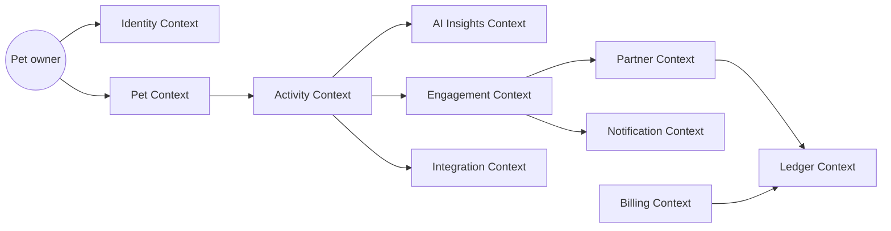
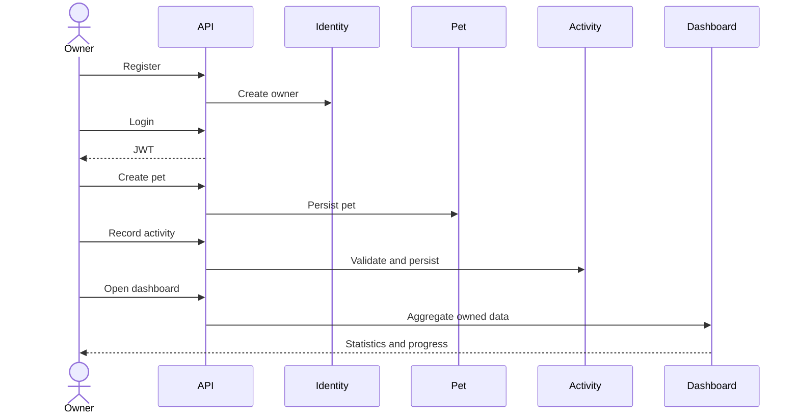
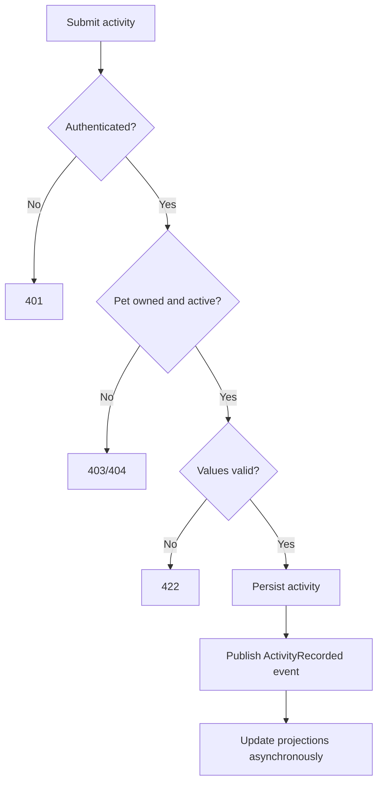
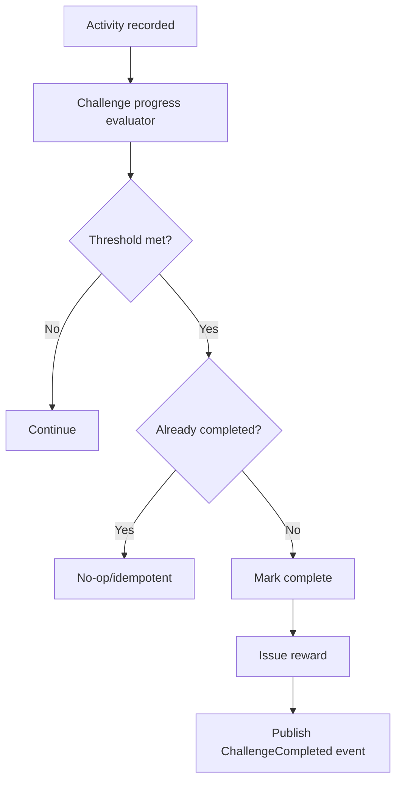
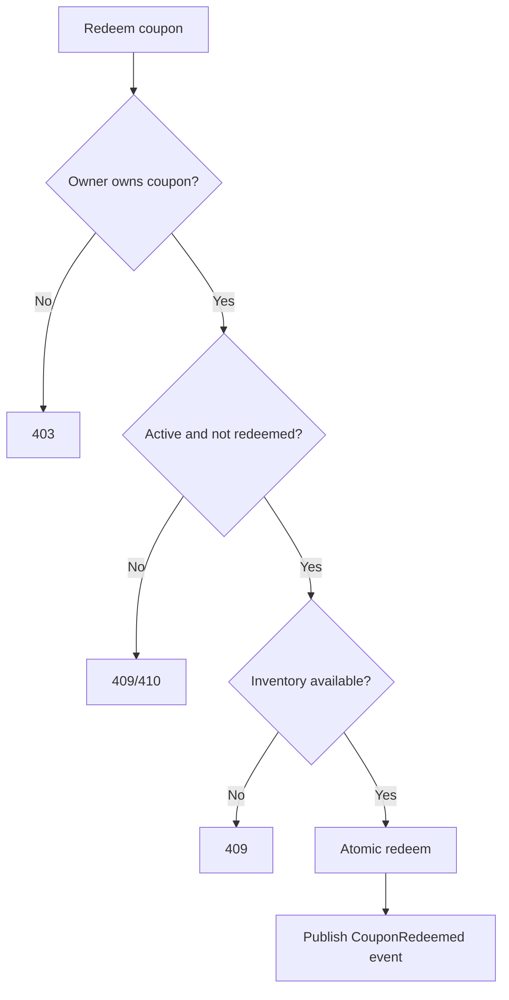
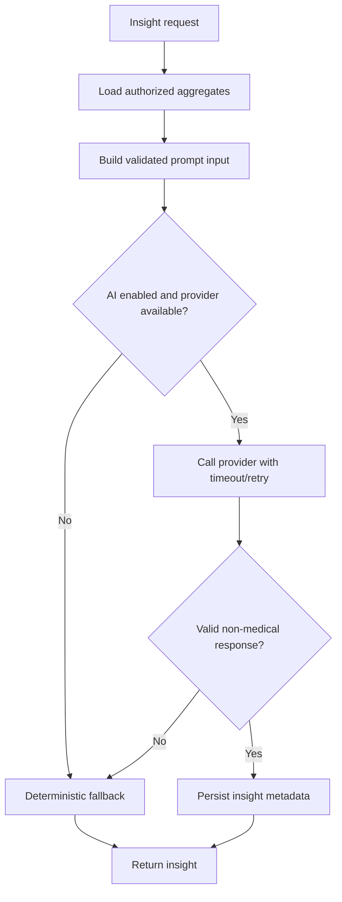
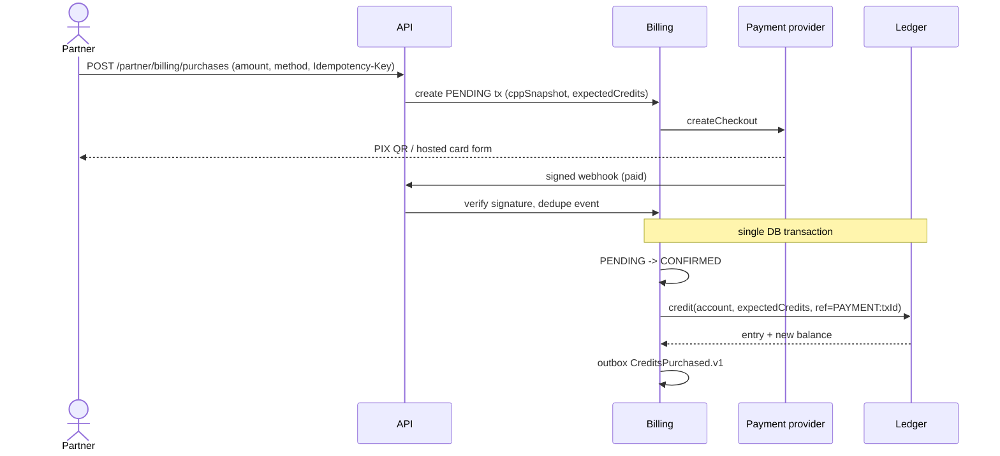
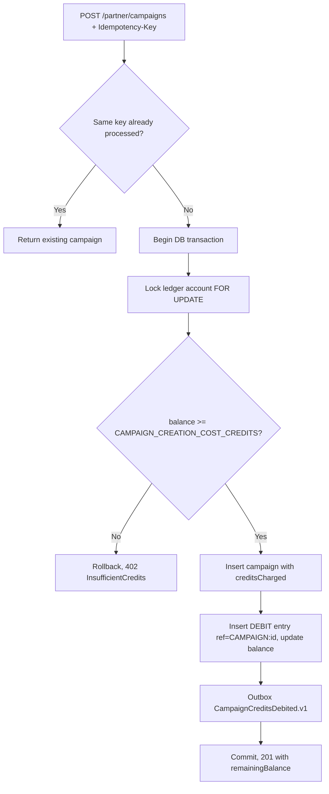
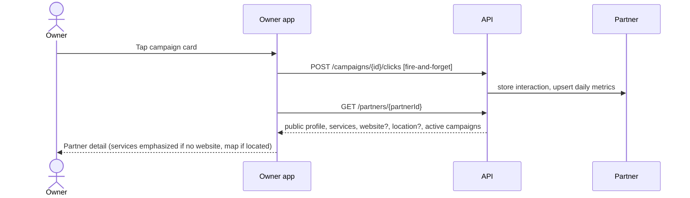
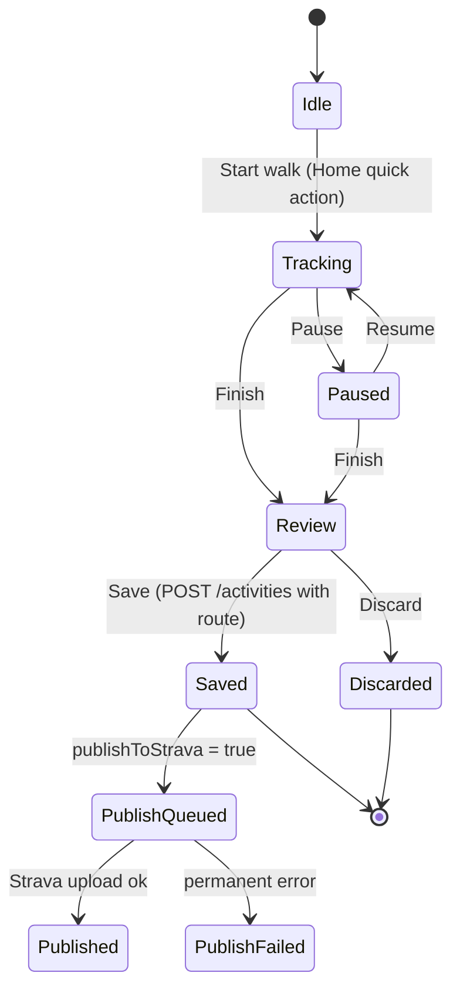

# Domain Model

## Strategic model

PawMotion AI is divided into bounded contexts with explicit ownership. The modular monolith preserves these boundaries in code packages and database schemas/tables, while avoiding premature network-service decomposition.

## Core aggregates

### Identity Context

- `Owner` aggregate: identity, credentials reference, display name, status.
- Value objects: `EmailAddress`, `OwnerId`.
- Invariants: email unique; owner can be disabled; credentials are never exposed by domain APIs.

### Pet Context

- `Pet` aggregate: identity, owner reference, species, birth date/age, size, preferences, lifecycle status.
- Value objects: `PetId`, `Species`, `PetSize`, `ActivityPreference`.
- Invariants: pet must belong to an owner; name required; age cannot be negative; inactive pets cannot receive new activities.

### Activity Context

- `Activity` aggregate: pet reference, activity type, source (`MANUAL`/`LIVE_TRACKING`), start time, duration, distance, optional notes, optional route (`ActivityRoute`: GeoJSON `Feature<LineString>`, start/end points), publish-to-Strava intent.
- `ActivityStatistics` read model: totals, averages, streaks, weekly progress.
- Value objects: `ActivityId`, `ActivityType`, `Distance`, `Duration`.
- Invariants: duration and distance non-negative; start time valid; pet must be active and owned by requester.

### AI Insights Context

- `Insight` aggregate: owner/pet scope, reporting period, generated text, provider metadata, validation status.
- Domain service: insight request validation and fallback selection.
- Invariants: no medical claims; response must match schema; fallback is deterministic.

### Engagement Context

- `WeeklyGoal`, `Streak`, `Badge`, `Challenge`, `ChallengeEnrollment`, `Progress`, `Reward`.
- Invariants: progress cannot exceed configured target unless explicitly allowed; completion is idempotent; badges are awarded once.

### Partner Context

- `BusinessProfile`, `PartnerPublicProfile` (categories, services, website, address, location), `Campaign`, `CampaignInteraction`, `CampaignDailyMetrics` (read model), `RewardOffer`, `Coupon`, `Redemption`.
- Value objects: `CampaignId`, `PartnerCategory`, `ServiceOffering`, `GeoPoint`, `InteractionType`.
- Invariants: coupon inventory cannot be oversold; redemption is idempotent; partner analytics are aggregate-only; a campaign stores `creditsCharged` and is created only if its ledger debit succeeds; publishing campaigns requires at least one category and one service.

### Billing Context

- `PaymentTransaction` aggregate: partner, amount, currency, CPP snapshot, expected credits, target ledger account, provider (AbacatePay), provider checkout id/url, idempotency key, status, version, timestamps.
- Value objects: `Money`, `CreditsPerCurrencyUnit`, `PaymentStatus`, `PaymentMethod`.
- Invariants: state machine `PENDING → CONFIRMED | FAILED | EXPIRED | CANCELED`, `CONFIRMED → DISPUTED | REFUNDED`, `DISPUTED → CONFIRMED | REFUNDED`; terminal states immutable; credits granted at most once and only on `CONFIRMED`.

### Ledger Context

- `Wallet` aggregate (one per partner, created at partner registration, status `ACTIVE`/`BLOCKED`) containing `LedgerAccount`s `MAIN`, `BONUS`, `PARTNER`; `LedgerEntry` append-only records. Wallet and accounts carry a JPA `@Version`; postings also lock account rows.
- Value objects: `Credits` (positive integer), `EntryDirection` (CREDIT/DEBIT), `LedgerReference` (type + id).
- Invariants: balance never negative; balance equals sum of entries; `(accountId, referenceType, referenceId, direction)` unique (split debits/refunds post one entry per account); closed accounts reject postings; debits consume `MAIN` → `BONUS` → `PARTNER` (split if needed); blocked wallets reject debits for new campaigns and purchases.

### Integration Context

- `StravaConnection` aggregate (owner, athlete id, encrypted tokens, scopes, auto-publish flag, status) and `StravaPublication` (activity id, status, Strava activity id, attempts, last error).
- Invariants: one active connection per owner; one publication per activity per connection; tokens never exposed.

## Major user journeys

## Activity recording flow

## Challenge completion flow

## Coupon redemption flow

## AI insight generation flow

## Credit purchase flow (REQ-BILL-001/002)

## Campaign creation with credit debit (REQ-CAMP-003)

## Campaign click to partner detail (REQ-CAMP-001, REQ-DISC-001)

## Live tracking and Strava publication (REQ-TRACK-001, REQ-STRAVA-002)

