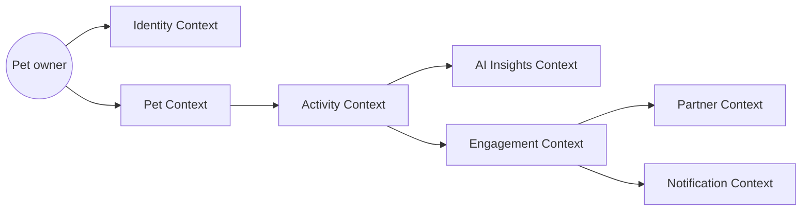
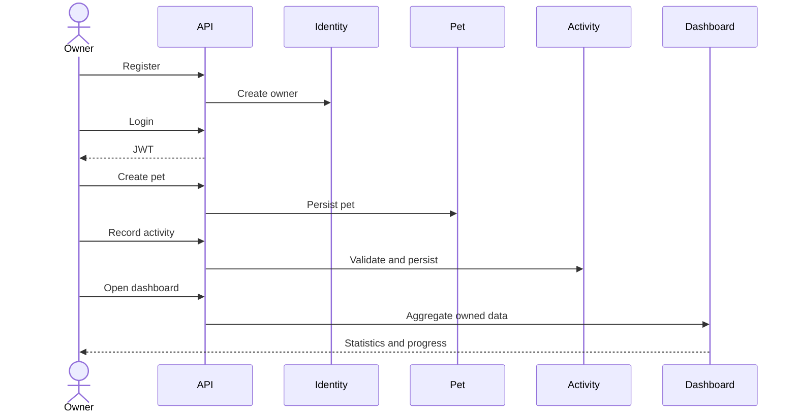
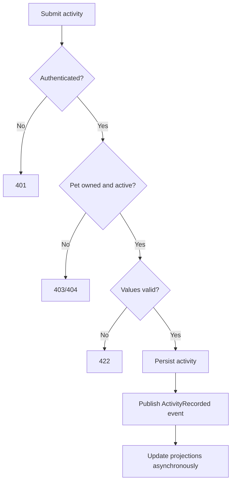
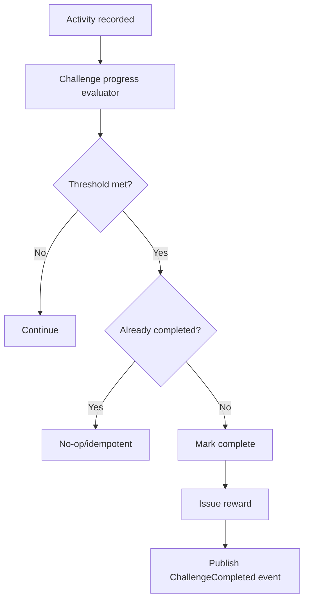
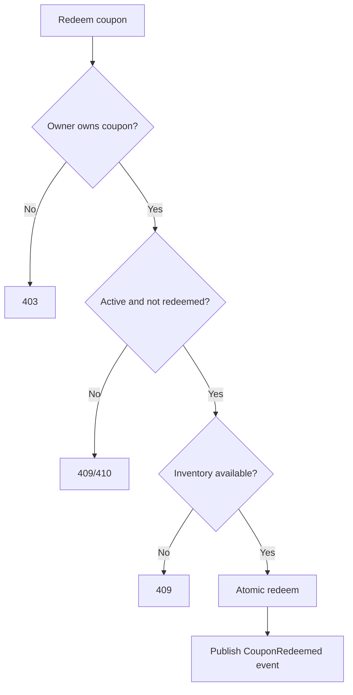
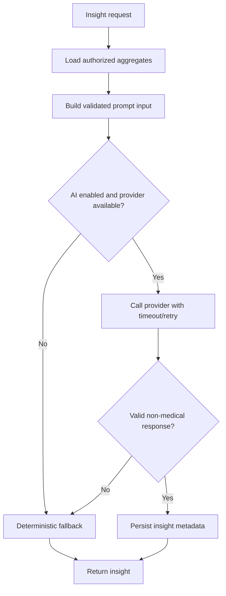

# Domain Model

## Strategic model

PawMotion AI is divided into bounded contexts with explicit ownership. The modular monolith preserves these boundaries in code packages and database schemas/tables, while avoiding premature network-service decomposition.

## Core aggregates

### Identity Context

- `Owner` aggregate: identity, credentials reference, display name, status.
- Value objects: `EmailAddress`, `OwnerId`.
- Invariants: email unique; owner can be disabled; credentials are never exposed by domain APIs.

### Pet Context

- `Pet` aggregate: identity, owner reference, species, birth date/age, size, preferences, lifecycle status.
- Value objects: `PetId`, `Species`, `PetSize`, `ActivityPreference`.
- Invariants: pet must belong to an owner; name required; age cannot be negative; inactive pets cannot receive new activities.

### Activity Context

- `Activity` aggregate: pet reference, activity type, start time, duration, distance, optional notes/route summary.
- `ActivityStatistics` read model: totals, averages, streaks, weekly progress.
- Value objects: `ActivityId`, `ActivityType`, `Distance`, `Duration`.
- Invariants: duration and distance non-negative; start time valid; pet must be active and owned by requester.

### AI Insights Context

- `Insight` aggregate: owner/pet scope, reporting period, generated text, provider metadata, validation status.
- Domain service: insight request validation and fallback selection.
- Invariants: no medical claims; response must match schema; fallback is deterministic.

### Engagement Context

- `WeeklyGoal`, `Streak`, `Badge`, `Challenge`, `ChallengeEnrollment`, `Progress`, `Reward`.
- Invariants: progress cannot exceed configured target unless explicitly allowed; completion is idempotent; badges are awarded once.

### Partner Context

- `BusinessProfile`, `Campaign`, `RewardOffer`, `Coupon`, `Redemption`.
- Invariants: coupon inventory cannot be oversold; redemption is idempotent; partner analytics are aggregate-only.

## Major user journeys

## Activity recording flow

## Challenge completion flow

## Coupon redemption flow

## AI insight generation flow

