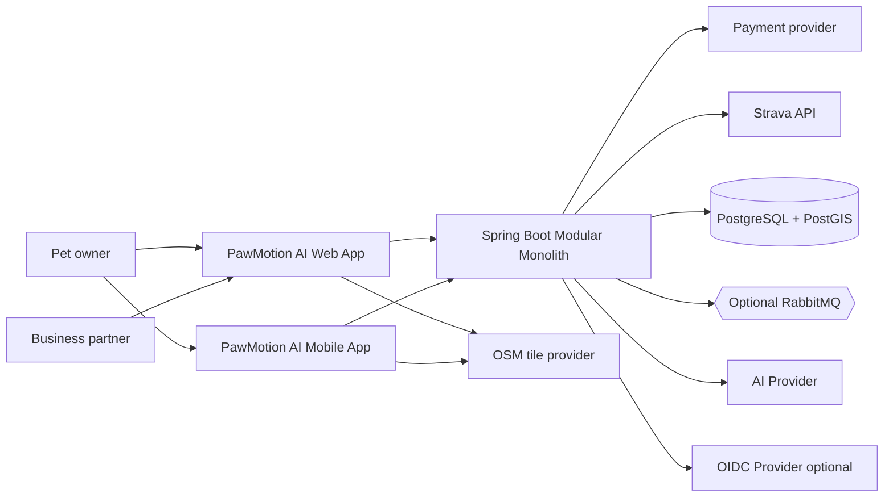
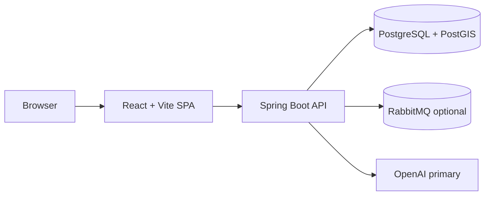

# Software Architecture

## Decision summary

PawMotion AI MVP uses a **Spring Boot modular monolith** with hexagonal architecture inside each bounded context. Bounded contexts are logical modules first and physical deployment units only when justified. This gives the team service-like separation without distributed-system operational cost.

## C4 System Context



## C4 Container diagram



## Logical modules

Each module follows:

```text
module/
├── domain/model|event|service|exception
├── application/port/in|out, usecase, dto
└── adapter/in/rest|messaging, adapter/out/persistence|messaging|external
```

The first implemented vertical slice covers Identity, Pet, Activity, dashboard statistics, and a safe AI insight fallback path.

## Component communication

| Producer | Consumer | Mechanism | Contract |
|---|---|---|---|
| Frontend | Backend | HTTPS REST | OpenAPI 3.1 |
| REST adapter | Application use case | Java interface | DTO validation |
| Application use case | Domain | Pure Java | Domain invariants |
| Use case | Repository port | Interface | Domain model |
| Persistence adapter | PostgreSQL | Spring Data JPA/Flyway | Module-owned tables |
| Activity module | Engagement/AI | Domain event | Event envelope schema |
| AI module | Provider | Port/adapter | Provider DTO + validation |

## Transaction boundaries

- A use case owns one local transaction for writes within its bounded context.
- Cross-context consistency uses events and idempotent consumers, not distributed transactions.
- Coupon redemption uses a single Partner-context transaction with row locking or optimistic constraints.
- Documented exception (ADR-0014): campaign creation + ledger debit, and payment confirmation + ledger credit, run in one local transaction through the Ledger inbound port, with row locking on the ledger account.

## Failure handling

- REST errors use RFC 9457 Problem Details.
- AI provider failures return deterministic fallback insights.
- Insufficient credits return `402` Problem Details; payment provider failures leave transactions `FAILED` without ledger changes.
- Strava failures never block activity saving; publications retry asynchronously.
- Event publication failures are isolated through outbox/inbox adapters when messaging is enabled.
- Database failures return `500` Problem Details and are logged with correlation IDs.

## Configuration management

Configuration is externalized through environment variables and Spring profiles: `local`, `test`, `demo`, `prod`. Secrets never enter Git.

### CR-2026-11 configuration

| Property | Environment variable | Owner |
|---|---|---|
| `app.billing.currency` | `BILLING_CURRENCY` | Billing |
| `app.billing.credits-per-currency-unit` | `BILLING_CREDITS_PER_CURRENCY_UNIT` (CPP) | Billing |
| `app.billing.min-purchase-amount` | `BILLING_MIN_PURCHASE_AMOUNT` | Billing |
| `app.billing.provider` | `PAYMENT_PROVIDER` (`abacatepay` / `fake`) | Billing |
| `app.billing.abacatepay.api-key` / `webhook-secret` | `ABACATEPAY_API_KEY`, `ABACATEPAY_WEBHOOK_SECRET` | Billing |
| `app.billing.abacatepay.credit-product-external-id` | `ABACATEPAY_CREDIT_PRODUCT_EXTERNAL_ID` | Billing |
| `app.billing.pending-ttl` / `partner-portal-base-url` | `BILLING_PENDING_TTL`, `PARTNER_PORTAL_BASE_URL` | Billing |
| `app.campaign.price-amount` | `CAMPAIGN_PRICE_AMOUNT` | Partner |
| `app.campaign.creation-cost-credits` | `CAMPAIGN_CREATION_COST_CREDITS` | Partner/Ledger |
| `app.campaign.duration-days` | `CAMPAIGN_DURATION_DAYS` | Partner |
| `app.engagement.ai-challenge-autopublish` | `CHALLENGE_AI_AUTOPUBLISH` | Engagement |
| `app.analytics.click-dedup-window` | `ANALYTICS_CLICK_DEDUP_WINDOW` | Partner |
| `app.maps.tile-url` / `style-url` | `MAP_TILE_URL`, `MAP_STYLE_URL` | Web/Mobile |
| `app.integration.strava.*` | `STRAVA_ENABLED`, `STRAVA_CLIENT_ID`, `STRAVA_CLIENT_SECRET`, `STRAVA_REDIRECT_URI` | Integration |
| `app.integration.token-encryption-key` | `INTEGRATION_TOKEN_ENCRYPTION_KEY` | Integration |

All values are validated at startup (`@Validated @ConfigurationProperties`); `.env.example` gains placeholders when each slice is implemented.

## As-built module inventory (post-refactor, 2026-11)

The monolith now carries both Java (baseline hexagonal) and Kotlin (phase-2+) modules:

- **Java**: `identity` (owner/partner auth, profile — identity fields only after ADR-0021), `pet`, `activity`, `aiinsights`, `partner` (campaigns v1 create), `billing` (purchases, webhooks), `ledger` (wallets, credit ledger), `configuration` (security, filters, error handling)
- **Kotlin**: `ads` (campaigns v2 lifecycle + admin review), `assistant` (AI chat + action cards), `booking` (service bookings), `community`, `content` (posts/media pages), `engagement` (XP, streaks, badges, challenges, leaderboard), `feed` (typed `feed_items`, reactions, comments), `health` (pet health passport/reminders), `map` (places, playdates, lost pets), `media` (uploads), `notification`, `petprofile`, `shared`

Cross-cutting: JWT auth filter, `ActiveAccountFilter`, `WriteRateLimitFilter`,
structured error handler, OpenAPI export (`exportOpenapi` task) feeding
`packages/api-client`. Removed in V19-era cleanup: the `social` package and the
recommendation/promotion stacks.
