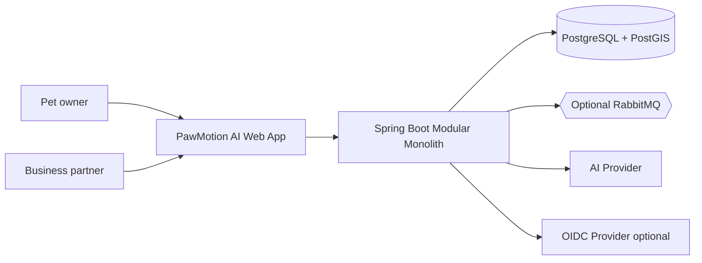
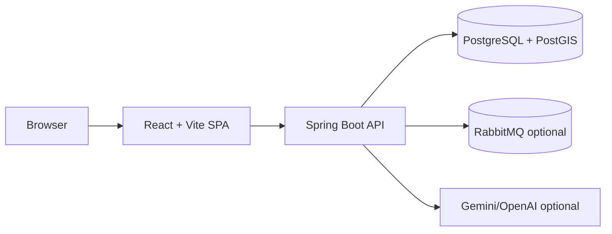

# Software Architecture

## Decision summary

PawMotion AI MVP uses a **Spring Boot modular monolith** with hexagonal architecture inside each bounded context. Bounded contexts are logical modules first and physical deployment units only when justified. This gives the team service-like separation without distributed-system operational cost.

## C4 System Context



## C4 Container diagram



## Logical modules

Each module follows:

```text
module/
├── domain/model|event|service|exception
├── application/port/in|out, usecase, dto
└── adapter/in/rest|messaging, adapter/out/persistence|messaging|external
```

The first implemented vertical slice covers Identity, Pet, Activity, dashboard statistics, and a safe AI insight fallback path.

## Component communication

| Producer | Consumer | Mechanism | Contract |
|---|---|---|---|
| Frontend | Backend | HTTPS REST | OpenAPI 3.1 |
| REST adapter | Application use case | Java interface | DTO validation |
| Application use case | Domain | Pure Java | Domain invariants |
| Use case | Repository port | Interface | Domain model |
| Persistence adapter | PostgreSQL | Spring Data JPA/Flyway | Module-owned tables |
| Activity module | Engagement/AI | Domain event | Event envelope schema |
| AI module | Provider | Port/adapter | Provider DTO + validation |

## Transaction boundaries

- A use case owns one local transaction for writes within its bounded context.
- Cross-context consistency uses events and idempotent consumers, not distributed transactions.
- Coupon redemption uses a single Partner-context transaction with row locking or optimistic constraints.

## Failure handling

- REST errors use RFC 9457 Problem Details.
- AI provider failures return deterministic fallback insights.
- Event publication failures are isolated through outbox/inbox adapters when messaging is enabled.
- Database failures return `500` Problem Details and are logged with correlation IDs.

## Configuration management

Configuration is externalized through environment variables and Spring profiles: `local`, `test`, `demo`, `prod`. Secrets never enter Git.
