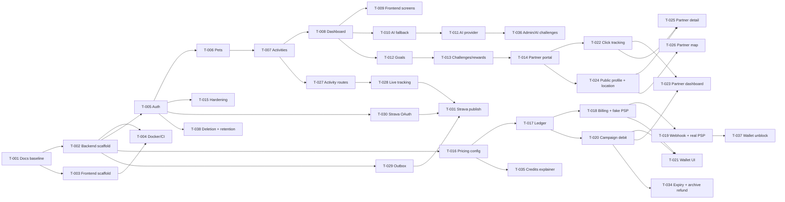

# Task Dependencies

## Critical path

Auth → Pet → Activity → Dashboard → Frontend integration. AI, gamification, and partner work should not block this path.

CR-2026-11 critical path: Pricing config → Ledger → Campaign debit → Partner dashboard. Payment provider selection (open question 11) gates T-019 only; the fake provider unblocks everything else.

## External dependencies

- PostgreSQL + PostGIS container image.
- Optional RabbitMQ container image.
- Optional AI provider credentials.
- Optional OIDC provider for production-like auth.
- Payment provider sandbox account with PIX/card and webhook signing secret (T-019).
- Strava API application (client id/secret, redirect URI) (T-030).
- OSM-based tile provider respecting usage policy; optional geocoding service (T-024, T-026).
- Expo development build for background location and native maps (T-026, T-028).

---

> **Status note (2026-11):** refactor phases all merged; dependency order recorded
> in `docs/refactor-report.md`. File retained for the original spec-phase record.
