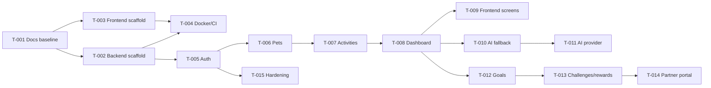

# Task Dependencies

## Critical path

Auth → Pet → Activity → Dashboard → Frontend integration. AI, gamification, and partner work should not block this path.

## External dependencies

- PostgreSQL + PostGIS container image.
- Optional RabbitMQ container image.
- Optional AI provider credentials.
- Optional OIDC provider for production-like auth.
